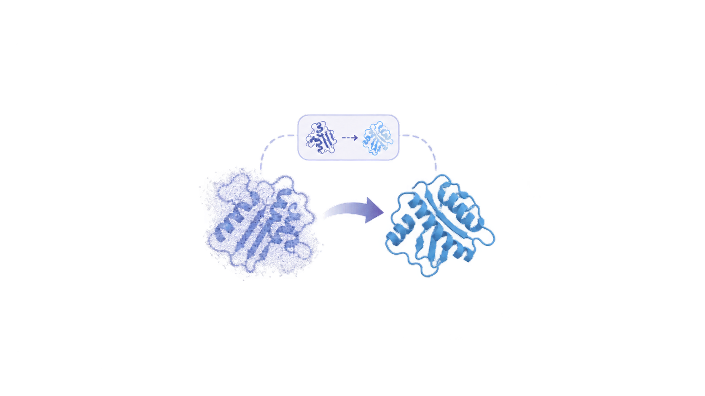

# pdd_in_bio

research on Parallel Decoding Distillation usability in protein domain

## Motivation

Lately there was a paper **Parallel Decoding Distillation for Fast Image and Video Generation (Neta Shaul
, Chao Liu
, Arash Vahdat,
, Julius Berner)**

Idea was to adapt **PDD** for biomolecular diffusion models distillation approaches

## Structure

configs/ - Configurations

configs/config.yaml - Configuration file for experiment

experiments/ - Experiments stats

... TBC

## Usage

run it however you want

## Comments

idk
